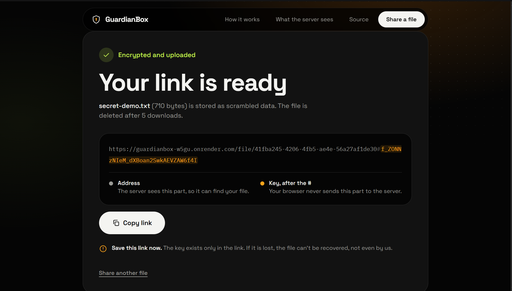
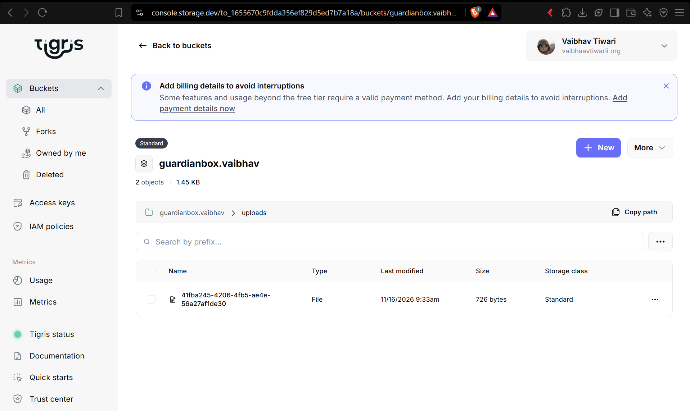
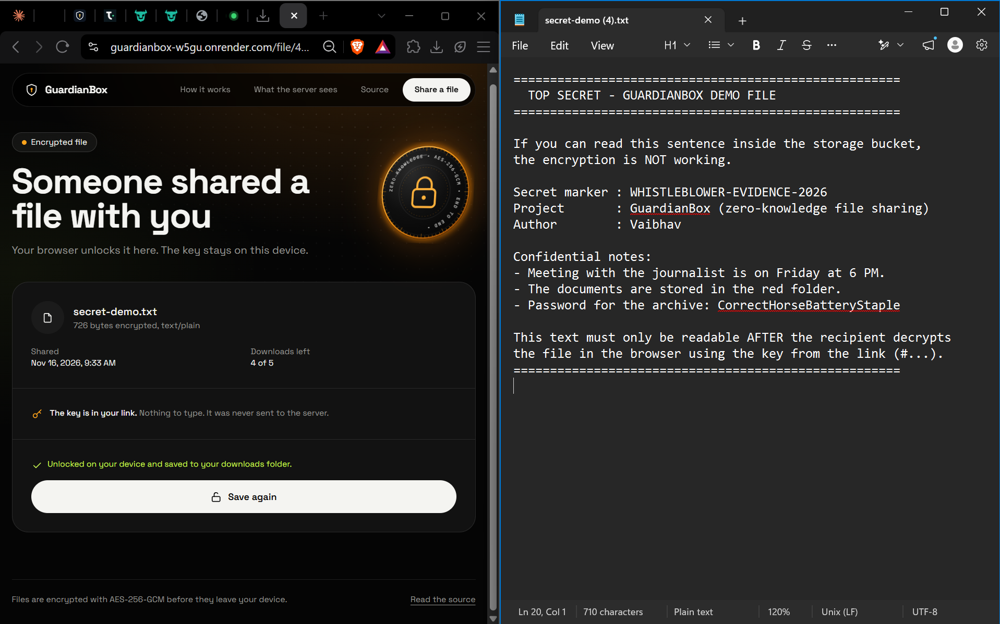

# 🛡️ GuardianBox — Zero-Knowledge Encrypted File Sharing

> **The server is blind.** Your files are encrypted in the browser before they ever leave your device. The server stores only unreadable ciphertext. Not even we can see what you share.

**🌐 Live demo: [guardianbox-w5gu.onrender.com](https://guardianbox-w5gu.onrender.com)** _(free hosting — if the app has been idle, the first load can take about a minute)_


---

## 📖 Overview

GuardianBox is an **End-to-End Encrypted (E2EE)** file sharing service designed for maximum privacy. Unlike traditional cloud storage (Google Drive, Dropbox), GuardianBox implements a **zero-knowledge architecture** — the server never has access to your encryption keys or plaintext data.

### How It Works

```
┌─────────────┐     Encrypted Blob     ┌──────────────┐     Ciphertext     ┌─────────────────┐
│   Browser   │ ─────────────────────▶ │   Express    │ ─────────────────▶ │  S3-compatible  │
│  (Encrypt)  │                        │   Server     │                    │  object storage │
└─────────────┘                        └──────────────┘                    └─────────────────┘
       │                                      │
       │  Key stays in URL hash (#)           │  Stores only encrypted data
       │  Never sent to server                │  Zero knowledge of contents
       ▼                                      ▼
  <host>/file/abc#MyKey               Database: metadata only (no keys)
```

1. **Upload**: the user selects a file → enters (or generates) a key → the browser splits the file into 4 MB chunks, encrypts each one with **AES-256-GCM**, and uploads the encrypted chunks one at a time. Only ciphertext ever leaves the browser.
2. **Share**: a link is generated with the file ID in the path and the decryption key in the **URL hash** (`#`). Browsers never send the hash fragment to the server.
3. **Download**: the recipient opens the link → the browser reads the key from the hash → fetches the encrypted blob → decrypts it client-side → saves the original file.
4. **Expire**: files are deleted automatically after a chosen time (**hourly cron job**) or after N downloads (**burn after reading**).

**Large files:** because every 4 MB chunk is encrypted, uploaded and decrypted on its own, the server never holds more than one chunk in memory (measured: a flat ~115 MB process while moving a 400 MB file), and the page shows a progress bar. Files up to **500 MB** are supported (`MAX_UPLOAD_MB`).

**Options in the UI:** expiry of 1 hour, 6 hours, 24 hours, 7 days or never; download limit of 1, 5, 10 or unlimited (the API accepts any positive number).

---

## 🏗️ Architecture

### Tech Stack

| Layer | Technology |
|-------|-----------|
| Frontend | React 19, TypeScript, Vite, Tailwind CSS 4 |
| Backend | Node.js, Express 4, TypeScript |
| Database | libSQL / SQLite via `@libsql/client` — a local file in development, hosted [Turso](https://turso.tech) in production. Metadata only. |
| Object storage | Any S3-compatible store via `@aws-sdk/client-s3` — RustFS locally, [Tigris](https://www.tigrisdata.com) in production (AWS S3 and MinIO also work) |
| Cryptography | Web Crypto API (AES-256-GCM, PBKDF2-SHA-256) |
| Scheduling | `node-cron` (hourly cleanup) |

### Cryptography Details

- **Algorithm**: AES-256-GCM (authenticated encryption — tampering is detected)
- **Key derivation**: PBKDF2 with 600,000 iterations and SHA-256
- **IV**: a fresh 12-byte random Initialization Vector for **every chunk**, stored in front of that chunk's ciphertext
- **Chunks**: 4 MiB of plaintext each. A stored chunk is `IV (12 bytes) || ciphertext || GCM tag (16 bytes)`, so every chunk adds 28 bytes
- **Position binding**: each chunk is authenticated with its index and a "last chunk" flag as AES-GCM additional data. If a server (or attacker) reorders, duplicates, drops or truncates chunks, decryption fails instead of returning a damaged file
- **Salt**: 16-byte random salt per file for key derivation (one PBKDF2 run per file, not per chunk)
- **Key transport**: URL hash fragment (`#`), which browsers never include in HTTP requests. Keys are percent-encoded in the link, so passphrases with spaces or non-English characters survive the round trip.
- **Module**: all crypto lives in `guardianbox/client/src/utils/cryptoUtils.ts`. A plain-JS twin, `cryptoUtils.js`, is used by the proof script and the Node tests.

### API

| Method | Endpoint | Purpose |
|--------|----------|---------|
| `POST` | `/api/files` | Start an upload: send metadata (name, size, chunk count, expiry, download limit) and the PBKDF2 salt, get a file ID |
| `PUT` | `/api/files/:id/chunks/:index` | Upload one encrypted chunk (raw bytes) |
| `POST` | `/api/files/:id/complete` | Verify every chunk arrived, then make the link usable |
| `GET` | `/api/files/:id/info` | File metadata (name, size, expiry, download count). Does not use up a download |
| `POST` | `/api/files/:id/download` | Claim one download (this is what counts toward the limit) and get a short-lived token, the salt and the chunk count |
| `GET` | `/api/files/:id/chunks/:index` | Download one encrypted chunk (needs the token in `X-Download-Token`) |
| `GET` | `/api/health` | Health check |

Init fields: `salt`, `originalName`, `mimeType`, `size`, `chunkSize`, `chunkCount`, plus optional `expiresIn` (**seconds**) and `maxDownloads`. The server checks that the chunk count matches the size and that every uploaded chunk has exactly the expected length. A file stays `pending` (not downloadable) until `complete` succeeds; unfinished uploads are deleted after an hour.

Expired or used-up files return `410 Gone`; unknown IDs, and files whose chunks have vanished from storage, return `404`. Download tokens are HMAC-signed, bound to one file ID and valid for two hours.

**Burn after reading with chunks:** a download is counted when it is claimed. The file is deleted (every chunk and the record) once the last allowed recipient has received the **last chunk**, so two overlapping downloads of a file with limit 2 both complete before anything is removed. If a recipient abandons a download halfway, the cleanup job removes the chunks after the token lifetime.

---

## 🚀 Getting Started

### Prerequisites

- Node.js **20+**
- npm
- Docker (for a local S3-compatible store) **or** an S3 bucket

### Setup

```bash
# Clone the repository
git clone https://github.com/vaibhaavtiwarii/Guardian-Box.git
cd Guardian-Box/guardianbox

# Environment variables
cp .env.example server/.env

# Install dependencies for the client and the server
npm run install:all
```

**Start a local S3-compatible store (RustFS):**

```bash
docker run -d --name rustfs \
  -e RUSTFS_ACCESS_KEY=minioadmin \
  -e RUSTFS_SECRET_KEY=minioadmin \
  -e RUSTFS_CONSOLE_ENABLE=true \
  -v rustfs-data:/data \
  -p 9000:9000 -p 9001:9001 \
  rustfs/rustfs:1.0.0
```

The console is at <http://127.0.0.1:9001/rustfs/console/> (login `minioadmin` / `minioadmin`). The server creates the `guardianbox-uploads` bucket automatically on first start. To use another provider, change the `S3_*` variables in `server/.env`.

**Run the app (two terminals):**

```bash
# Terminal 1 — API on :3001
cd server
npm run dev

# Terminal 2 — UI on :5173
cd client
npm run dev
```

Open <http://localhost:5173>.

### Configuration (`server/.env`)

| Variable | Default | Purpose |
|----------|---------|---------|
| `PORT` | `3001` | API port |
| `TURSO_DATABASE_URL` / `TURSO_AUTH_TOKEN` | *(empty)* | Hosted libSQL database. Leave empty locally to use a SQLite file (`server/data/guardianbox.db`) |
| `S3_ENDPOINT` | `http://localhost:9000` | S3-compatible endpoint |
| `S3_BUCKET` | `guardianbox-uploads` | Bucket name |
| `S3_REGION` | `us-east-1` | Region |
| `S3_ACCESS_KEY` / `S3_SECRET_KEY` | `minioadmin` | Storage credentials (change in production) |
| `S3_FORCE_PATH_STYLE` | `true` | `true` for local RustFS/MinIO, `false` for hosted providers like Tigris |
| `S3_STRICT` | `false` | `true` = never fall back to local disk; the server refuses to start if the bucket is unreachable |
| `MAX_UPLOAD_MB` | `500` | Largest file a user may share (plaintext MB). Files are chunked, so this is not limited by server memory |
| `TRUST_PROXY` | *(empty)* | Set to `1` behind a reverse proxy (Render) so rate limiting sees real client IPs |
| `CORS_ORIGIN` | *(any)* | Comma-separated allowed origins in production |
| `RATE_LIMIT_PER_MIN` | `120` | Per-IP request limit on `/api` |
| `CHUNK_RATE_LIMIT_PER_MIN` | `1500` | Separate per-IP limit for chunk transfers (a big file is hundreds of requests) |
| `DOWNLOAD_TOKEN_SECRET` | *(random per start-up)* | Signs download tokens. Render generates one from `render.yaml` |

> If S3 is unreachable and `S3_STRICT` is not `true`, the server falls back to local disk (`server/storage/`) for convenience during development.

---

## ☁️ Deployment (free tier, no credit card)

The app deploys as **one web service** that serves both the API and the built React UI, plus two free hosted services for data:

| Piece | Service | Role |
|-------|---------|------|
| Web service | [Render](https://render.com) free web service | Runs Express and serves the built UI (HTTPS, which the Web Crypto API requires, is automatic) |
| Metadata DB | [Turso](https://turso.tech) | File records (no keys, no plaintext) — needed because Render's free filesystem is ephemeral |
| Encrypted blobs | [Tigris](https://www.tigrisdata.com) | S3-compatible object storage |
| Uptime monitor | [UptimeRobot](https://uptimerobot.com) | Pings `/api/health` every 5 minutes so the free instance stays awake |

**Steps**
1. Create a private Tigris bucket and an access key limited to it. Create a Turso database and an auth token.
2. In Render choose **New → Blueprint**, select this repository (it reads [`render.yaml`](render.yaml)) and enter the secret values when prompted: `S3_BUCKET`, `S3_ACCESS_KEY`, `S3_SECRET_KEY`, `TURSO_DATABASE_URL`, `TURSO_AUTH_TOKEN`.
3. Every push to `main` redeploys automatically.
4. In UptimeRobot add an **HTTP(s)** monitor for `https://<your-service>.onrender.com/api/health` with a 5-minute interval.

**Free-tier behaviour:** Render spins a free service down after 15 minutes without traffic, and the first request afterwards takes about a minute. The UptimeRobot ping keeps it awake, but a short 502 right after a redeploy is normal. The hourly cleanup job cannot run while the service sleeps, so cleanup also runs on every start-up, and expiry and download limits are enforced on every request regardless.

---

## 🔒 Security Audit

### What's Protected

| Attack vector | Mitigation |
|--------------|------------|
| Server compromise | Zero-knowledge: the server stores only ciphertext. No keys in the DB. |
| Database leak | Only encrypted-blob references and metadata. No plaintext, no keys. |
| Man-in-the-middle | HTTPS in production. The key is in the URL hash and never appears in HTTP requests. |
| Brute force (key) | AES-256-GCM with PBKDF2 (600K iterations). Infeasible for a strong key. |
| IV reuse | Fresh random 12-byte IV for every chunk. |
| Tampering | AES-GCM authentication tag — modified ciphertext fails to decrypt. Chunk index and last-chunk flag are authenticated too, so reordering, duplicating or truncating chunks is detected. |
| Reuse of a leaked link | Optional download limit and auto-expiry; expired files are deleted from storage. |
| Burn-after-read race | The download slot is claimed with an atomic SQL `UPDATE ... WHERE download_count < max_downloads`. |
| Abuse / scraping | Per-IP rate limit, restrictable CORS, `no-store` and `Referrer-Policy: no-referrer` headers. |
| Script injection | Content-Security-Policy on the UI (scripts only from the same origin) and a strict `default-src 'none'` policy on `/api`. |
| Input abuse | File IDs validated as UUIDs; `salt` validated as base64; chunk count and every chunk's exact length validated; total size capped; download tokens are signed. |

### Known Limitations & Risks

1. **Link loss = data loss**: if the user loses the sharing link (which contains the decryption key), the file is **irrecoverable**. There is no "forgot password" flow — that would require the server to know the key, defeating zero-knowledge.

2. **Browser and host trust**: the user must trust the JavaScript the host serves. A compromised host or an XSS flaw could exfiltrate the key. Mitigation: a strict CSP is set, and the app has no third-party scripts. Further hardening would be Subresource Integrity or a signed, self-hosted build. Fonts load from Google Fonts; that request never includes the URL fragment.

3. **Metadata exposure**: the server knows file sizes, upload times, and IP addresses. File *contents* are hidden, but traffic patterns are not.

4. **Insecure link sharing**: if the link is sent over an insecure channel (plain HTTP, unencrypted email), the key could be intercepted. Share links through an E2EE messenger (Signal, WhatsApp).

5. **Memory limits moved to the browser**: the server handles one 4 MB chunk at a time, but the recipient's browser assembles the decrypted file in memory before saving it, so very large files (the cap is 500 MB) need a device with enough RAM. Uploads are not resumable: if the browser closes halfway, the unfinished upload is discarded after an hour and the sender starts again. Streaming the decrypted file straight to disk (File System Access API) would remove the browser limit and is future work.

6. **Filename and MIME type are not encrypted**: they are stored server-side in plaintext so the recipient can see them before decrypting. Anyone with DB access learns file names, sizes and timestamps.

7. **Weak user-chosen keys**: the key is placed in the share link and also used for PBKDF2. A short passphrase is brute-forceable by anyone who obtains the ciphertext; prefer **Generate key**.

8. **No forward secrecy**: the same key decrypts the file until it expires. If the key is compromised at any point, access to that file is compromised.

9. **Download limit counts requests, not recipients**: anyone with the link can consume a download, and a failed decryption still uses one, because the download is counted when it is claimed. Combine a download limit with a short expiry for sensitive files.

---

## 🔬 Proof of Zero-Knowledge Storage (Walkthrough)

Deliverable requirement: *a walkthrough showing that the file stored in the S3 bucket is indeed encrypted and unreadable without the client-side key.*

The proof has two parts.

### Part 1 — Inspect the object in the bucket (live deployment)

These steps were run against the live site at <https://guardianbox-w5gu.onrender.com>, with the object stored in the Tigris bucket.

1. Upload a small text file containing a recognizable sentence through the UI.
2. Open the Tigris dashboard and browse the bucket. Under `uploads/` there is a folder named with a random UUID. It holds the encrypted chunks as objects named `0`, `1`, `2`, ..., with no file extension (a small file has just one).
3. Download one of the chunk objects and open it in a text editor: it is random bytes, and your sentence appears nowhere.
4. Open the share link and decrypt: the original text comes back. With a wrong key, decryption fails.

| Step | Screenshot |
|------|-----------|
| Share link generated after encrypt + upload |  |
| Encrypted chunk object in the bucket (random UUID folder, numbered chunks) |  |
| Stored chunk opened in a text editor — unreadable |  |
| Recipient decrypts with the key from the link |  |
| Wrong key rejected |  |

Command-line check on the downloaded chunk (no output means the word is not present; use a word from your own file):

```powershell
Select-String -Path .\downloaded-object -Pattern "your-word-here" -Encoding ASCII
```

### Part 2 — Automated end-to-end script

```bash
# from guardianbox/ — the API server must be running
npm run proof
```

The script encrypts a ~200 KB message as four chunks, uploads them, inspects the stored bytes and the database record, decrypts with the correct key, confirms a wrong key is rejected, and tests burn-after-reading. The run below used local-disk storage (`STORAGE_MODE=local`) so the script can read and hex-dump the stored chunks itself; against an S3 bucket it skips that dump and the manual bucket check in Part 1 is the proof.

Actual output:

```
======================================================================
 GUARDIANBOX - ZERO-KNOWLEDGE E2EE VERIFICATION & S3 PROOF
======================================================================

[1] CLIENT-SIDE ENCRYPTION (Web Crypto API):
    Original Plaintext: "TOP SECRET WHISTLEBLOWER DISCLOSURE 2026: UNREDACTED EVIDENCE ARCHIVE" (repeated, 204820 bytes)
    Generated Client Key: "GuardianKey_yCbRePDthtRsdTfb6Kyo6opm"
    Deriving AES-256 key with PBKDF2 (600,000 iterations)...
    Key Derivation Salt: 7unMy1J4ISUcLe5SXI7o6Q==
    Splitting into 4 chunks of up to 65536 bytes, each with its own random 12-byte IV...
    Encrypted chunk sizes: 65564, 65564, 65564, 8240 bytes (each = data + 28)

[2] CLIENT UPLOADS CIPHERTEXT TO BACKEND:
    Upload Successful! (4 chunks)
    Stored File ID: 46dceb08-9105-4a9f-be82-99578d3ef22e
    Max Downloads: 2
    Full Share URL: http://localhost:5173/file/46dceb08-9105-4a9f-be82-99578d3ef22e#GuardianKey_yCbRePDthtRsdTfb6Kyo6opm
    * Notice: The hash portion "#GuardianKey_yCbRePDthtRsdTfb6Kyo6opm" is NEVER sent to the server in HTTP requests.

[3] PROOF: INSPECTING STORAGE & DATABASE ON THE SERVER:
    Stored objects: 4 chunks under uploads/46dceb08-9105-4a9f-be82-99578d3ef22e/ (204932 bytes in total)
    Hex dump of the first stored chunk (first 48 bytes):
    0abc0854c206bd7c6fde11660a34e898f44a51c6eb10bfb6bcafac3729d9f2cb6348aa63a6a414d854a382205e9be64a
    Do the stored bytes contain "TOP SECRET"? => NO (VERIFIED ZERO-KNOWLEDGE)
    Do the stored bytes contain the secret key? => NO (VERIFIED ZERO-KNOWLEDGE)
    Database Record for this file:
    {
      id: "46dceb08-9105-4a9f-be82-99578d3ef22e",
      original_name: "whistleblower_report.txt",
      size: 204932,
      chunk_count: 4,
      download_count: 0,
      s3_key: "uploads/46dceb08-9105-4a9f-be82-99578d3ef22e",
      salt: "7unMy1J4..."
    }
    -> ZERO-KNOWLEDGE CONFIRMED: No encryption keys, passwords, or plaintext stored anywhere in database!

[4] RECIPIENT OPENS SHARE LINK & DECRYPTS:
    Recipient browser reads key from URL hash: "GuardianKey_yCbRePDthtRsdTfb6Kyo6opm"
    Claiming a download and fetching 4 encrypted chunks from /api/files/46dceb08-9105-4a9f-be82-99578d3ef22e/chunks/...
    Downloaded 4 encrypted chunks (204932 bytes)
    Decrypting in browser with Web Crypto AES-256-GCM...
    Decrypted Text (first line): "TOP SECRET WHISTLEBLOWER DISCLOSURE 2026: UNREDACTED EVIDENCE ARCHIVE"
    Byte-for-byte exact match? => SUCCESS (100% MATCH)

[5] VERIFYING SECURITY: ATTEMPT DECRYPTION WITH WRONG KEY:
    SUCCESS: Decryption with wrong key rejected by AES-GCM authentication tag check.
    Error caught: The operation failed for an operation-specific reason

[6] EPHEMERAL STORAGE TEST (Burn after 2 downloads):
    Performing 2nd download (reaching max limit of 2)...
    2nd Download: all chunks delivered (final copy)
    Chunk objects left in storage: 0
    Performing 3rd download attempt (should be deleted / 410 or 404)...
    3rd Download Status: 404 (SUCCESS: File deleted from database and storage)

======================================================================
 ALL VERIFICATION CHECKS & PROOFS PASSED PERFECTLY!
======================================================================
```


---

## 🧪 Testing

```bash
# Server + crypto tests (from guardianbox/) — build the server first
npm run build:server
npm test

# Vitest suite for the client crypto module
cd client
npm test
```

**Crypto tests** (`tests/crypto.test.mjs` and the client Vitest suite):
- `encrypt(data, key)` followed by `decrypt(ciphertext, key)` returns the original data (text and 64 KB of binary)
- a wrong password fails to decrypt (authentication tag failure)
- tampered ciphertext is rejected (AES-GCM integrity)
- a fresh salt and IV are generated on every call
- chunked encryption: several chunks round-trip, every chunk gets its own IV, chunks that are reordered, moved or truncated are rejected, and a tampered or too-short chunk is rejected

**Server tests** (`tests/server.test.mjs`) start the built server on a random port with a temporary database and local blob storage, then call the real API:
- a multi-chunk file round-trips with real encryption; the stored bytes never contain the plaintext; a wrong key is rejected on the first chunk
- a file is not downloadable until the upload is complete; chunk uploads are validated (exact size, index range, no uploads after completion)
- `expiresIn` is read as seconds, and an expired file returns `410` on info, download start and chunk requests
- chunks need a valid download token for that exact file
- **burn after reading**: the last finished download deletes every chunk and the record; two overlapping downloads of a limit-2 file both complete before anything is deleted
- parallel download starts of a one-download file let exactly one succeed (atomic claim)
- unknown or malformed IDs return `404`; invalid salt, chunk count or size are rejected; files over the size limit return `413`
- a chunk deleted from storage turns the link into a `404` and removes the record
- the file-info response never contains a key or plaintext

---

## 📁 Project Structure

```
Guardian-Box/
├── README.md
├── LICENSE
├── render.yaml                     # Render Blueprint (free web service)
├── proof/                          # Proof screenshots
└── guardianbox/
    ├── .env.example
    ├── client/                     # React frontend
    │   └── src/
    │       ├── components/         # Shell, drop zone, key input, limits, share link, hero art
    │       ├── pages/              # Upload and Download pages
    │       ├── utils/
    │       │   ├── cryptoUtils.ts  # 🔐 Web Crypto API module
    │       │   ├── cryptoUtils.js  # JS version of the same module
    │       │   ├── cryptoUtils.test.ts
    │       │   ├── api.ts          # API client
    │       │   └── format.ts       # Sizes, dates and limit wording
    │       └── types/              # TypeScript interfaces
    ├── server/                     # Express backend
    │   └── src/
    │       ├── config/             # DB and S3 configuration
    │       ├── controllers/        # Request handlers
    │       ├── middleware/         # Raw chunk body parser and size limits
    │       ├── models/             # Database models
    │       ├── routes/             # API routes
    │       ├── services/           # Object storage service
    │       └── utils/              # Hourly cleanup cron job, download tokens
    ├── scripts/e2e-proof.mjs       # End-to-end proof script
    └── tests/                      # crypto.test.mjs, server.test.mjs
```

---

## 👤 Author

**Vaibhav Tiwari** — [@vaibhaavtiwarii](https://github.com/vaibhaavtiwarii)

Built as a Cybersecurity project on end-to-end encrypted file sharing.

---

## 📜 License

MIT © 2026 Vaibhav Tiwari — see [LICENSE](LICENSE).

---

*Built with privacy in mind. Your files, your keys, your rules.*
