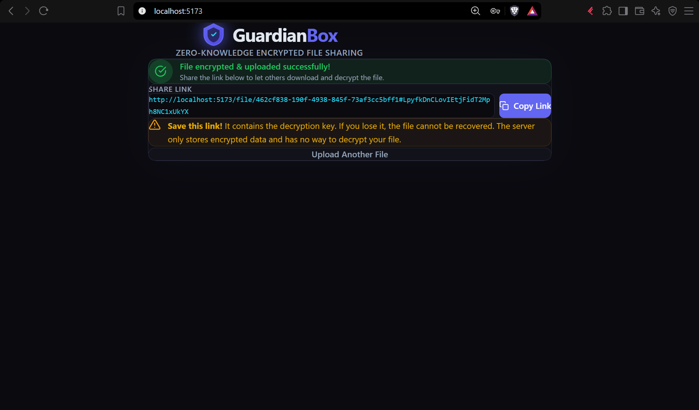
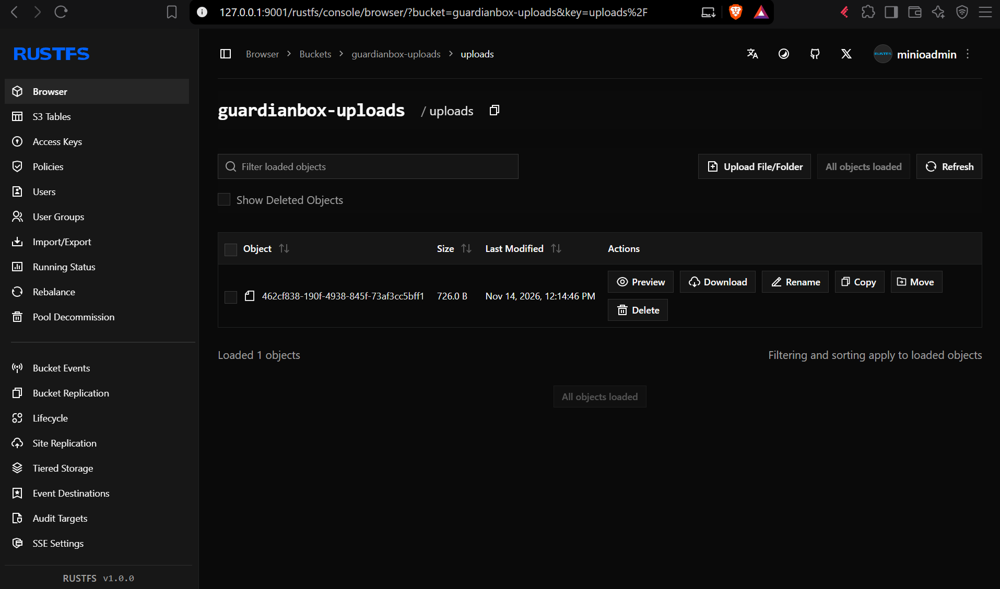
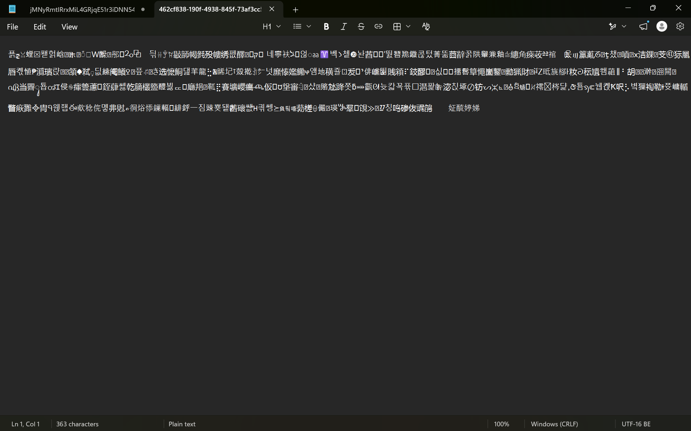
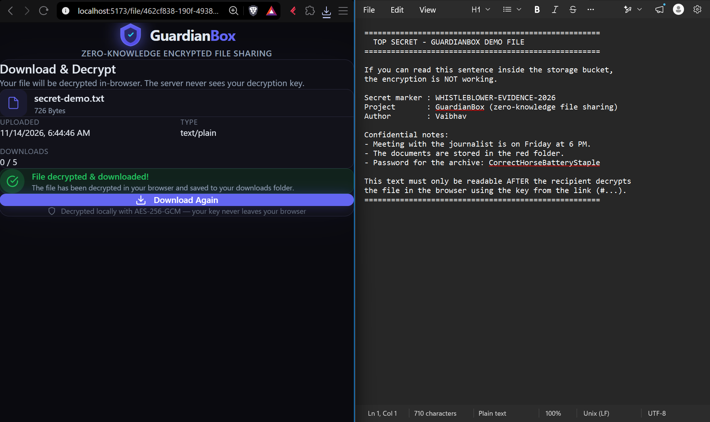
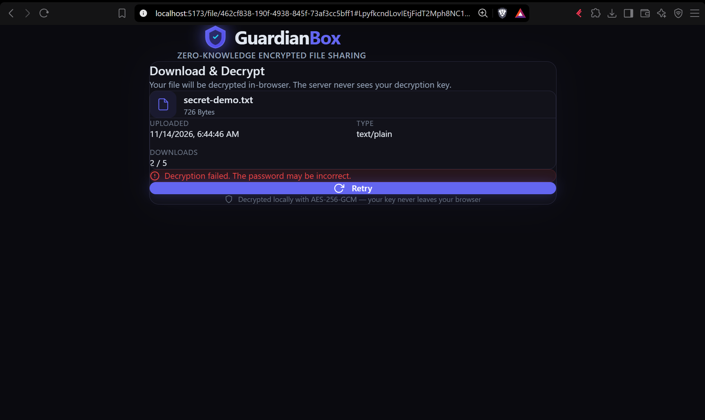

# 🛡️ GuardianBox — Zero-Knowledge Encrypted File Sharing

> **The server is blind.** Your files are encrypted in the browser before they ever leave your device. The server stores only unreadable ciphertext. Not even we can see what you share.


---

## 📖 Overview

GuardianBox is an **End-to-End Encrypted (E2EE)** file sharing service designed for maximum privacy. Unlike traditional cloud storage (Google Drive, Dropbox), GuardianBox implements a **zero-knowledge architecture** — the server never has access to your encryption keys or plaintext data.

### How It Works

```
┌─────────────┐     Encrypted Blob     ┌──────────────┐     Ciphertext     ┌─────────────────┐
│   Browser   │ ─────────────────────▶ │   Express    │ ─────────────────▶ │  S3-compatible  │
│  (Encrypt)  │                        │   Server     │                    │  object storage │
└─────────────┘                        └──────────────┘                    └─────────────────┘
       │                                      │
       │  Key stays in URL hash (#)           │  Stores only encrypted data
       │  Never sent to server                │  Zero knowledge of contents
       ▼                                      ▼
  <host>/file/abc#MyKey               Database: metadata only (no keys)
```

1. **Upload**: User selects a file → enters (or auto-generates) a password → file is encrypted with **AES-256-GCM** in the browser → encrypted blob is sent to the server
2. **Share**: A link is generated containing the file ID in the path and the decryption key in the **URL hash** (`#`). The hash fragment is **never sent to the server** by the browser.
3. **Download**: Recipient opens the link → browser extracts the key from the hash → fetches the encrypted blob from the server → decrypts it client-side → downloads the original file
4. **Expire**: Files are deleted automatically after a set time (hourly cron job) or after N downloads (burn after reading).

---

## 🏗️ Architecture

### Tech Stack

| Layer | Technology |
|-------|-----------|
| Frontend | React 19, TypeScript, Vite, Tailwind CSS 4 |
| Backend | Node.js, Express 4, TypeScript |
| Database | libSQL / SQLite via `@libsql/client` — a local file in development, hosted [Turso](https://turso.tech) in production. Metadata only. |
| Object Storage | AWS S3 or any S3-compatible store (developed against RustFS; MinIO also works) via `@aws-sdk/client-s3` |
| Cryptography | Web Crypto API (AES-256-GCM, PBKDF2-SHA-256) |

### Cryptography Details

- **Algorithm**: AES-256-GCM (authenticated encryption — tampering is detected)
- **Key Derivation**: PBKDF2 with 600,000 iterations and SHA-256
- **IV**: 12-byte random Initialization Vector per encryption
- **Salt**: 16-byte random salt per encryption for key derivation
- **Key Transport**: Via URL hash fragment (`#`), which browsers never include in HTTP requests
- **Module**: all crypto lives in one place — `guardianbox/client/src/utils/cryptoUtils.ts` (a plain-JS twin, `cryptoUtils.js`, is used by the proof script and the Node tests)

### API

| Method | Endpoint | Purpose |
|--------|----------|---------|
| `POST` | `/api/files/upload` | Store ciphertext + IV + salt + expiry metadata |
| `GET` | `/api/files/:id/info` | File metadata (name, size, expiry, download count) |
| `GET` | `/api/files/:id` | Download the encrypted blob (counts toward the download limit) |
| `GET` | `/api/health` | Health check |

---

## 🚀 Getting Started

### Prerequisites

- Node.js **20+**
- npm
- Docker (for a local S3-compatible store) **or** an AWS S3 bucket

### Setup

```bash
# Clone the repository
git clone https://github.com/vaibhaavtiwarii/Guardian-Box.git
cd Guardian-Box/guardianbox

# Environment variables
cp .env.example server/.env

# Install dependencies
cd client
npm install
cd ../server
npm install
cd ..
```

**Start a local S3-compatible store (RustFS):**

```bash
docker run -d --name rustfs \
  -e RUSTFS_ACCESS_KEY=minioadmin \
  -e RUSTFS_SECRET_KEY=minioadmin \
  -e RUSTFS_CONSOLE_ENABLE=true \
  -v rustfs-data:/data \
  -p 9000:9000 -p 9001:9001 \
  rustfs/rustfs:1.0.0
```

The console is at <http://127.0.0.1:9001/rustfs/console/> (login `minioadmin` / `minioadmin`). The server creates the `guardianbox-uploads` bucket automatically on first start. To use AWS S3 or another provider instead, change the `S3_*` variables in `server/.env`.

**Run the app (two terminals):**

```bash
# Terminal 1 — API on :3001
cd server
npm run dev

# Terminal 2 — UI on :5173
cd client
npm run dev
```

Open <http://localhost:5173>.

### Configuration (`server/.env`)

| Variable | Default | Purpose |
|----------|---------|---------|
| `PORT` | `3001` | API port |
| `TURSO_DATABASE_URL` / `TURSO_AUTH_TOKEN` | *(empty)* | Hosted libSQL database. Leave empty locally to use a SQLite file (`server/data/guardianbox.db`) |
| `S3_FORCE_PATH_STYLE` | `true` | `true` for local RustFS/MinIO, `false` for hosted providers like Tigris |
| `TRUST_PROXY` | *(empty)* | Set to `1` behind a reverse proxy (Render) so rate limiting sees real client IPs |
| `S3_ENDPOINT` | `http://localhost:9000` | S3-compatible endpoint |
| `S3_BUCKET` | `guardianbox-uploads` | Bucket name |
| `S3_REGION` | `us-east-1` | Region |
| `S3_ACCESS_KEY` / `S3_SECRET_KEY` | `minioadmin` | Storage credentials (change in production) |
| `S3_STRICT` | `false` | `true` = never fall back to local disk; the server refuses to start if the bucket is unreachable |
| `MAX_UPLOAD_MB` | `50` | Maximum encrypted upload size |
| `CORS_ORIGIN` | *(any)* | Comma-separated allowed origins in production |
| `RATE_LIMIT_PER_MIN` | `120` | Per-IP request limit |

> If S3 is unreachable and `S3_STRICT` is not `true`, the server falls back to local disk (`server/storage/`) for convenience during development.

---

## ☁️ Deployment (free tier, no credit card)

The app deploys as **one web service** that serves both the API and the built React UI, plus two free hosted services for data:

| Piece | Service | Role |
|-------|---------|------|
| Web service | [Render](https://render.com) free web service | Runs Express and serves the built UI (HTTPS is required for the Web Crypto API and is provided automatically) |
| Metadata DB | [Turso](https://turso.tech) | File records (no keys, no plaintext) — needed because Render's free filesystem is ephemeral |
| Encrypted blobs | [Tigris](https://www.tigrisdata.com) | S3-compatible object storage |

**Steps**
1. Create a private Tigris bucket and an access key limited to it. Create a Turso database and an auth token.
2. In Render choose **New → Blueprint**, select this repository (it reads [`render.yaml`](render.yaml)) and enter the secret values when prompted: `S3_BUCKET`, `S3_ACCESS_KEY`, `S3_SECRET_KEY`, `TURSO_DATABASE_URL`, `TURSO_AUTH_TOKEN`.
3. Every push to `main` redeploys automatically.

**Free-tier behaviour:** Render spins the service down after 15 minutes without traffic, so the first request afterwards takes about a minute. The hourly cleanup job cannot run while it sleeps, so cleanup also runs on every start-up, and expiry / download limits are enforced on every request regardless.

**Live demo:** _add the Render URL here after the first deploy_

---

## 🔒 Security Audit

### What's Protected

| Attack Vector | Mitigation |
|--------------|------------|
| Server compromise | Zero-knowledge: server stores only ciphertext. No keys in DB. |
| Database leak | Only encrypted blob references and metadata. No plaintext, no keys. |
| Man-in-the-middle | HTTPS in production. Key is in URL hash, never in HTTP requests. |
| Brute force (key) | AES-256-GCM with PBKDF2 (600K iterations). Computationally infeasible for a strong key. |
| IV reuse | Fresh random 12-byte IV per encryption. |
| Tampering | AES-GCM authentication tag — modified ciphertext fails to decrypt. |
| Replay attacks | Unique file IDs, optional download limits, auto-expiration. |
| Burn-after-read race | Download slot claimed with an atomic SQL `UPDATE ... WHERE download_count < max_downloads`. |
| Abuse / scraping | Per-IP rate limit, restrictable CORS, `no-store` and `Referrer-Policy: no-referrer` headers. |
| Input abuse | File IDs validated as UUIDs; `iv`/`salt` validated as base64; upload size capped. |

### Known Limitations & Risks

1. **Link Loss = Data Loss**: If the user loses the sharing link (which contains the decryption key), the file is **irrecoverable**. There is no "forgot password" flow — that would require the server to know the key, defeating zero-knowledge.

2. **Browser Trust**: The user must trust their browser and the JavaScript served. A compromised CDN or an XSS attack could exfiltrate the key. Mitigation: Subresource Integrity (SRI) and a strict Content-Security-Policy on the host that serves the frontend (the API already sends a restrictive CSP).

3. **Metadata Exposure**: The server knows file sizes, upload times, and IP addresses. The file *contents* are hidden, but traffic patterns are not.

4. **URL Sharing Security**: If the link is shared over an insecure channel (e.g., plain HTTP, unencrypted email), the key could be intercepted. Users should share links via E2EE messaging (Signal, WhatsApp).

5. **Large files are buffered, not streamed**: the whole file is encrypted in one AES-GCM operation and buffered in server memory, so uploads are capped (default 50 MB, `MAX_UPLOAD_MB`). True streaming would need chunked AES-GCM (per-chunk IVs) and multipart S3 uploads — listed as future work.

6. **Filename and MIME type are not encrypted**: they are stored server-side in plaintext so the recipient can see them before decrypting. Anyone with DB access learns file names, sizes and timestamps.

7. **Weak user-chosen passwords**: the password is placed in the share link and also used for PBKDF2. A short password is brute-forceable by anyone who obtains the ciphertext; prefer the auto-generated key.

8. **No Forward Secrecy**: The same key decrypts the file forever (until the file expires). If the key is compromised at any point, all historical access is compromised.

9. **Download limit counts requests, not recipients**: anyone who has the link can consume a download. Combine a download limit with a short expiry for sensitive files.

---

## 🔬 Proof of Zero-Knowledge Storage (Walkthrough)

Deliverable requirement: *A walkthrough showing that the file stored in the S3 bucket is indeed encrypted and unreadable without the client-side key.*

The proof has two parts. Both were run with `S3_STRICT=true`, so the server was talking to the real S3-compatible bucket and **not** the local-disk fallback.

### Part 1 — Inspect the object in the bucket

1. Upload `secret-demo.txt` through the UI (it contains the marker `WHISTLEBLOWER-EVIDENCE-2026` in plain text).
2. Open the storage console and browse `guardianbox-uploads/uploads/`. The object has a random UUID name and no extension.
3. Download the object and open it: it is random bytes, and the marker text appears nowhere.
4. Decrypt through the share link: the original text comes back. With a wrong key, decryption fails.

| Step | Screenshot |
|------|-----------|
| Share link generated after encrypt + upload |  |
| Object in the bucket (random UUID, no extension) |  |
| Stored object opened in a text editor — unreadable |  |
| Recipient decrypts with the key from the link |  |
| Wrong key rejected |  |

Command-line check on the downloaded object (no output means the marker is not present):

```powershell
Select-String -Path .\downloaded-object -Pattern "WHISTLEBLOWER" -Encoding ASCII
```

### Part 2 — Automated end-to-end script

```bash
# from guardianbox/ — the API server must be running
npm run proof
```

The script encrypts a message, uploads the ciphertext, checks that the database record holds no key or plaintext, decrypts with the correct key, confirms a wrong key is rejected, and tests burn-after-reading.

Actual output:

```
======================================================================
 GUARDIANBOX - ZERO-KNOWLEDGE E2EE VERIFICATION & S3 PROOF
======================================================================

[1] CLIENT-SIDE ENCRYPTION (Web Crypto API):
    Original Plaintext: "TOP SECRET WHISTLEBLOWER DISCLOSURE 2026: UNREDACTED EVIDENCE ARCHIVE"
    Generated Client Key: "GuardianKey_yWpWsIiBrrsEYFmaVU8l-7WJ"
    Encrypting in browser via AES-256-GCM with PBKDF2 (600,000 iterations)...
    Ciphertext Byte Length: 85 bytes
    Initialization Vector (IV): wCU0bNaKOpVGtq2G
    Key Derivation Salt: PQv4BmeBXSN1wHZhBBtGIA==

[2] CLIENT UPLOADS CIPHERTEXT TO BACKEND:
    Upload Successful!
    Stored File ID: b77e1b07-86a8-451b-bab7-bbe135156a59
    Max Downloads: 2
    Full Share URL: http://localhost:5173/file/b77e1b07-86a8-451b-bab7-bbe135156a59#GuardianKey_yWpWsIiBrrsEYFmaVU8l-7WJ
    * Notice: The hash portion "#GuardianKey_yWpWsIiBrrsEYFmaVU8l-7WJ" is NEVER sent to the server in HTTP requests.

[3] PROOF: INSPECTING STORAGE & DATABASE ON THE SERVER:
    Database Record for this file:
    {
      id: "b77e1b07-86a8-451b-bab7-bbe135156a59",
      original_name: "whistleblower_report.pdf",
      size: 85,
      download_count: 0,
      s3_key: "uploads/b77e1b07-86a8-451b-bab7-bbe135156a59",
      salt: "PQv4BmeB...",
      iv: "wCU0bNaK..."
    }
    -> ZERO-KNOWLEDGE CONFIRMED: No encryption keys, passwords, or plaintext stored anywhere in database!

[4] RECIPIENT OPENS SHARE LINK & DECRYPTS:
    Recipient browser reads key from URL hash: "GuardianKey_yWpWsIiBrrsEYFmaVU8l-7WJ"
    Fetching encrypted blob from GET /api/files/b77e1b07-86a8-451b-bab7-bbe135156a59...
    Downloaded encrypted blob (85 bytes)
    Decrypting in browser with Web Crypto AES-256-GCM...
    Decrypted Text: "TOP SECRET WHISTLEBLOWER DISCLOSURE 2026: UNREDACTED EVIDENCE ARCHIVE"
    Byte-for-byte exact match? => SUCCESS (100% MATCH)

[5] VERIFYING SECURITY: ATTEMPT DECRYPTION WITH WRONG KEY:
    SUCCESS: Decryption with wrong key rejected by AES-GCM authentication tag check.
    Error caught: The operation failed for an operation-specific reason

[6] EPHEMERAL STORAGE TEST (Burn after 2 downloads):
    Performing 2nd download (reaching max limit of 2)...
    2nd Download Status: 200 (Delivered final copy & burned)
    Performing 3rd download attempt (should be deleted / 410 or 404)...
    3rd Download Status: 410 (SUCCESS: File deleted from database and storage)

======================================================================
 ALL VERIFICATION CHECKS & PROOFS PASSED PERFECTLY!
======================================================================
```

> The script inspects the database record directly. When the blob is in S3 rather than on local disk it does not print a hex dump of the object — that inspection is the manual bucket check in Part 1.

---

## 🧪 Testing

```bash
# Node test runner (from guardianbox/)
npm test

# Vitest suite for the client crypto module
cd client
npm test
```

The tests verify that:
- `encrypt(data, key)` followed by `decrypt(ciphertext, key)` returns the original data (text and 64 KB of binary)
- a wrong password fails to decrypt (authentication tag failure)
- tampered ciphertext is rejected (AES-GCM integrity)
- a fresh salt and IV are generated on every call
- generated keys are unique and base64 encoding round-trips

---

## 📁 Project Structure

```
Guardian-Box/
├── README.md
├── proof/                          # Proof screenshots
└── guardianbox/
    ├── client/                     # React frontend
    │   └── src/
    │       ├── components/         # UI components
    │       ├── pages/              # Upload and Download pages
    │       ├── utils/
    │       │   ├── cryptoUtils.ts  # 🔐 Web Crypto API module
    │       │   ├── cryptoUtils.js  # JS version of the same module
    │       │   ├── cryptoUtils.test.ts
    │       │   └── api.ts          # API client
    │       └── types/              # TypeScript interfaces
    ├── server/                     # Express backend
    │   └── src/
    │       ├── config/             # DB and S3 configuration
    │       ├── controllers/        # Request handlers
    │       ├── middleware/         # Multer upload middleware
    │       ├── models/             # Database models
    │       ├── routes/             # API routes
    │       ├── services/           # Object storage service
    │       └── utils/              # Hourly cleanup cron job
    ├── scripts/e2e-proof.mjs       # End-to-end proof script
    └── tests/crypto.test.mjs       # Node crypto tests
```

---

## 👤 Author

**Vaibhav Tiwari** — [@vaibhaavtiwarii](https://github.com/vaibhaavtiwarii)

Built as a Cybersecurity project on end-to-end encrypted file sharing.

---

## 📜 License

MIT © 2026 Vaibhav Tiwari — see [LICENSE](LICENSE).

---

*Built with privacy in mind. Your files, your keys, your rules.*
